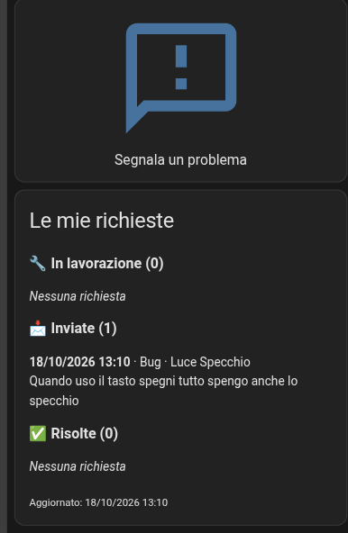
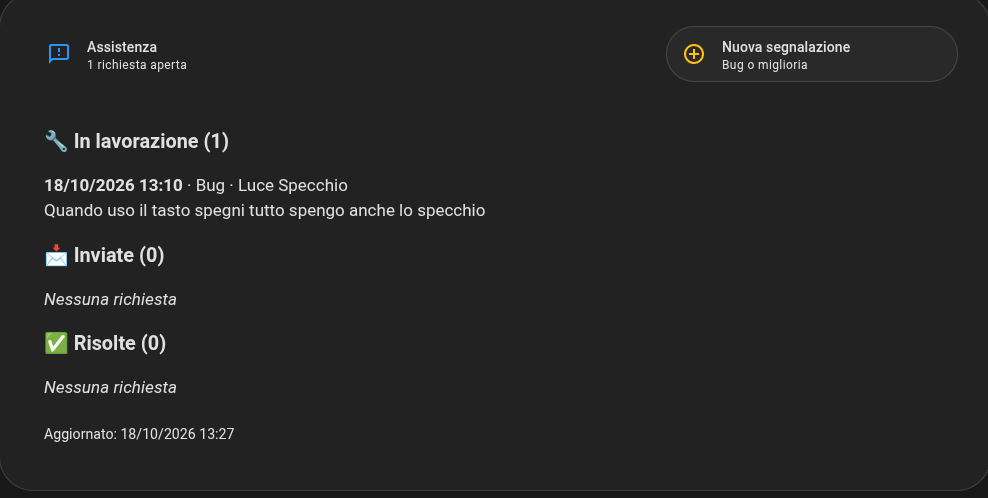
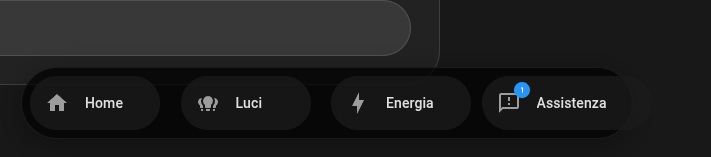

# Client requests for Home Assistant

[🇮🇹 Italiano](README.md) · 🇬🇧 English

A button in your clients' Home Assistant that lets them send you **bugs** and **improvement requests** for their smart home.
Requests arrive on **Telegram** and are stored in a **Vikunja** to-do list on your server;
the client sees the status of each request on their dashboard (*Sent → In progress → Resolved*).
If your server is off, the request is queued on the client's HA and sent automatically once the server is back online.

```
 Client's HA                            Your server
┌────────────────────────┐   HTTPS    ┌──────────────────────────────┐
│ Button → form          │──────────► │ n8n  /webhook/segnalazioni   │──► Telegram
│ (script with fields)   │  token     │       │                      │
│                        │            │       ▼                      │
│ Local queue (to-do)    │            │ Vikunja (to-do, 1 project)   │
│ when server is off     │            │       ▲                      │
│                        │◄────────── │ n8n  /webhook/segnalazioni-  │
│ "My requests" page     │  every 10' │       stato                  │
└────────────────────────┘            └──────────────────────────────┘
```

> The user interface (form, notifications, dashboard texts) and the code comments are in **Italian**.
> Entity and file names are explained below; translate the visible texts if your clients need another language.

## Screenshots

<table>
<tr>
<td width="38%" valign="top"><br><sub>Phone: button + list of requests</sub></td>
<td valign="top"><br><sub>Tablet: support page (Mushroom)</sub><br><br><br><sub>Navigation bar with open-requests badge</sub></td>
</tr>
</table>

## Contents

| Path | What it is |
|---|---|
| `server/vikunja/docker-compose.yml` | Vikunja (self-hosted to-do list) |
| `server/n8n/segnalazioni-clienti.json` | n8n workflow: intake, Telegram, Vikunja, status |
| `homeassistant/packages/segnalazioni.yaml` | The whole client side in one package |
| `homeassistant/secrets.example.yaml` | Values for the client's `secrets.yaml` |
| `homeassistant/dashboard/` | Ready-made cards: native, Bubble Card pop-up, Mushroom tablet |
| `assets/avatar-bot.png` | Picture for the Telegram bot |

## Requirements

- A server with **Docker** and **n8n** (already installed).
- n8n reachable from the internet over HTTPS (Cloudflare Tunnel, reverse proxy, …) — only the `/webhook/` path needs to be exposed.
- A dedicated **Telegram bot**.
- Client side: **Home Assistant 2024.10** or later.
- Optional, for the cards: Bubble Card, Mushroom, card-mod, layout-card (HACS).

---

## Installation

### 1. Vikunja

```bash
mkdir -p ~/vikunja && cd ~/vikunja
# copy server/vikunja/docker-compose.yml here
mkdir files db && sudo chown 1000 files db
```

In the compose file replace `IP-SERVER` and `VIKUNJA_SERVICE_JWTSECRET` (`openssl rand -hex 32`), then:

```bash
docker compose up -d
docker compose exec vikunja /app/vikunja/vikunja user create -u admin -e you@example.com
```

From `http://IP-SERVER:3456`:

1. create a project (e.g. **Client requests**): the number in the URL `/projects/2/…` is the **project ID**;
2. create the label **`In lavorazione`** (exactly this spelling — it means "in progress");
3. **Settings → API Tokens**: preset **TASK MANAGEMENT** (or at least *Tasks → Create, Read, Read All*), long expiry. Copy the token.

### 2. Telegram bot

1. **@BotFather** → `/newbot` → copy the token.
2. Open the bot and press **Start** (otherwise it can't message you).
3. Your chat ID: message **@userinfobot**.
4. Optional: `/setuserpic` with `assets/avatar-bot.png` (send it as a *photo*).

### 3. n8n

1. **Workflows → Import from file** → `server/n8n/segnalazioni-clienti.json`.
2. Credentials:
   - **Header Auth** "Vikunja": Name `Authorization`, Value `Bearer VIKUNJA-TOKEN` (in **Fixed** mode). Assign it to the *Crea task Vikunja* and *Leggi task Vikunja* nodes.
   - **Telegram API** with the bot token → *Notifica Telegram* node.
3. Replace the placeholders:

| Node | What |
|---|---|
| Verifica cliente | one token per client (`openssl rand -hex 24`) and their name |
| Crea task Vikunja | `IP-SERVER` and `ID-PROGETTO` (project ID) in the URL |
| Leggi task Vikunja | `IP-SERVER` in the URL |
| Formatta stato | `const PROGETTO = 2;` (number, no quotes) |
| Notifica Telegram | `TUO-CHAT-ID` (your chat ID) and `IP-SERVER` in the text |

4. **Save** and **activate / publish** the workflow.

Test from your LAN:

```bash
curl -X POST http://IP-SERVER:5678/webhook/segnalazioni \
  -H "X-Segnalazioni-Token: TOKEN-CLIENTE-1" -H "Content-Type: application/json" \
  -d '{"tipo":"Bug","stanza":"Test","descrizione":"Prova","inviata_il":"01/01/2026 12:00","in_coda":false}'
# → {"ok":true}, task in Vikunja, Telegram message

curl http://IP-SERVER:5678/webhook/segnalazioni-stato -H "X-Segnalazioni-Token: TOKEN-CLIENTE-1"
# → JSON containing the "Prova" request
```

Then delete the test task in Vikunja.

### 4. Exposing it to the internet

Publish n8n over HTTPS and expose **only** `/webhook/`. Examples:

- **Cloudflare Zero Trust**: one Access application for the whole n8n domain, and a second one for `your-domain/webhook/` with a *Bypass → Everyone* policy.
- **Nginx Proxy Manager**, *Advanced* tab of the proxy host:
  ```nginx
  location ~ ^/(?!webhook/) { return 403; }
  ```

The n8n editor then stays reachable only from LAN/VPN (or behind Cloudflare login).

### 5. Client's Home Assistant

1. **Settings → Devices & services → Add integration → Local To-do**, name **`Segnalazioni in attesa`** (pending requests).
2. Add the values from `homeassistant/secrets.example.yaml` to `secrets.yaml` (public URLs and the client's token).
3. Enable packages in `configuration.yaml` (if not already):
   ```yaml
   homeassistant:
     packages: !include_dir_named packages
   ```
4. Copy `homeassistant/packages/segnalazioni.yaml` to `/config/packages/`.
5. **Developer tools → YAML → Check configuration**, then **Restart**.
6. Check in **States**: `sensor.segnalazioni_assistenza` = `0` and `binary_sensor.server_assistenza_online` = `on`.

> Scripts and automations defined in a package can't be edited from the UI. If you prefer that, copy them into *Scripts* and *Automations* and remove them from the package.

### 6. Dashboard

Pick one of the cards in `homeassistant/dashboard/`:

| File | Result | Plugins |
|---|---|---|
| `1-card-semplice.yaml` | button + list of requests | none |
| `2-popup-bubble-card.yaml` + `2-pulsante-tile.yaml` | small button opening a pop-up | Bubble Card |
| `3-tablet-mushroom-card.yaml` + `3-tablet-pulsante-barra.yaml` | tablet page + nav-bar button with badge | Mushroom, card-mod, layout-card |

---

## Day-to-day use

In Vikunja, for each request:

| What you do | What the client sees |
|---|---|
| nothing | 📩 Inviata (sent) |
| add the `In lavorazione` label | 🔧 In lavorazione (in progress) |
| mark the task as done | ✅ Risolta (resolved) |

The client's page refreshes every 10 minutes, right after each submission and after the queue is flushed.
To force it: `homeassistant.update_entity` on `sensor.segnalazioni_assistenza`.

## Adding a client

1. Generate a token: `openssl rand -hex 24`.
2. In the n8n **Verifica cliente** node add a line `'TOKEN': 'Client name',` and save.
3. On the client's HA repeat step 5 of the installation with their token.

Each client only sees their own requests: n8n derives the client name from the token, not from a parameter the client could change.

## Servers that shut down at night

The package assumes the server is off **from 03:00 to 09:00**:

- the automation doesn't retry in that window and flushes the queue at **09:05**;
- the card shows a dedicated 🌙 notice.

If your server is always on, remove the `time` condition and the 09:05 trigger from the automation; if it has different hours, change them in the package and in the card (`3 <= now().hour < 9`).

## Known issues

| Symptom | Cause / fix |
|---|---|
| `webhook "POST segnalazioni" is not registered` | n8n workflow not active/published. |
| `Bad request – Invalid model provided` on *Leggi task Vikunja* | Recent Vikunja versions removed `/tasks/all`: use `/api/v1/tasks?per_page=500` (already set in the workflow). |
| 401/403 from Vikunja nodes | Token lacks permissions: recreate it with the TASK MANAGEMENT preset. |
| `{"ok":false,"errore":"token non valido"}` | The HA token differs from the one in the *Verifica cliente* node. |
| The card doesn't change when you add "In lavorazione" | The template sensor trigger must not use `to`/`not_to` (otherwise attribute-only changes are ignored). The package already does this right. |
| Completed requests disappear instead of moving to *Risolte* | If your Vikunja version excludes completed tasks, append `&filter=done = true \|\| done = false` to the *Leggi task Vikunja* URL. |
| The Mushroom button overflows the nav bar | In a `horizontal-stack` all buttons must have the same width. |

## License

[MIT](LICENSE)
